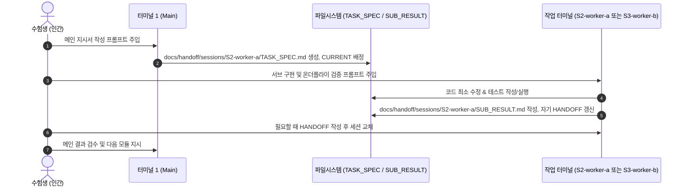

# 🧭 Cofa Probe 실전 당일 라이브 런북 (Chronological Exam-Day Runbook)

> **수험생 전용 안내:** 원본 단계와 요청 문구를 유지한 통합본입니다.
> **시각은 10:00 시작의 예시입니다.** 실제 시각은 plan_time.py와 docs/handoff/CURRENT.md를 따릅니다.
> **추가 구성:** 반도체 지식과 제출 확정 전 서술형 대비, docs 공유, 세션별 명세와 결과 파일.
> 원본은 upstream/chichochoi/foruser.md에 보존합니다. 공식 규칙과 AGENTS.override.md가 우선합니다.
> 이 문서는 원본의 시간순 단계와 복사할 요청 문구를 바탕으로 한 **실전 진행 안내**입니다.
> 각 단계별로 **⏱ 권장 시각**, **👉 수행 행동**, **📋 복붙용 명령어/프롬프트**, 그리고 **✅ 완료 시그널**을 엄격히 갖추고 있습니다.
> 화면 한쪽에 이 문서를 켜두고 순서대로 복사하여 터미널과 에이전트에 입력하세요.

---

## 본시험 8단계: 문서와 스킬 사용 순서

기본은 S1-main과 S2-worker-a이며, 독립 작업이 있을 때 S3-worker-b를 추가한다.
아래 순서는 뒤의 원본 기반 상세 단계와 대응한다. 고정 시각보다 CURRENT의 실제 남은 시간을 따른다.

| 순서 | 응시자가 할 일 | 세션이 읽고 남길 문서 | 스킬과 상세 위치 |
|---|---|---|---|
| 1. 입장과 설치 | 감독 연결, 과제 폴더 확인, 설치 명령 실행 | 실제 과제 README, .probe-kit/docs/RULES.md | 아직 스킬 호출 없음. 아래 1단계와 2단계 점검 명령 |
| 2. 메인 시작 | S1-main을 열고 실제 시작, 마감과 제한 시간 전달 | 원본 AGENTS, AGENTS.override, 공유 규칙 → docs/handoff/CURRENT.md | S1에서 $probe-workflow. 2단계 |
| 3. 과제 파악 | 목표, 제출물과 성공 기준 확인 | docs/scenarios.md의 9개 유형 → .probe-kit/runtime/REQUIREMENTS.md | 앞서 시작한 workflow에서 진행. 해당 case 지침 선택. 3단계 |
| 4. 담당자 질문 | 초안을 검토해 직접 전송하고 답을 S1에 전달 | docs/interview.md, dm_question.md → QUESTION_LOG와 REQUIREMENTS | S1에서 $probe-interview. 질문 준비 또는 새 답변 반영 시. 4~5단계 |
| 5. 방향 합의와 배정 | 방식과 범위 승인 | DECISIONS → 작업자별 TASK_SPEC | S1에서 $probe-decisions. 중요한 선택이나 방향 변경 때. 6단계와 6.5단계 |
| 6. 구현과 검토 반복 | S2를 시작하고 완료 결과 경로를 S1에 전달 | TASK_SPEC과 지정 case 지침 → SUB_RESULT, 자기 보고서 | 오류가 나면 담당 세션의 $probe-debug, 완료 판단에는 $probe-verify. 6.5~7단계 |
| 7. 제출 전 확인 | 실제 동작, 미충족 조건과 선택 이유 확인 | REQUIREMENTS와 EVIDENCE 대조, DECISIONS와 docs/written-prep.md | S1에서 $probe-verify, 이해도 확인에는 확정 전 $probe-explain. 8~12단계 |
| 8. 제출 확정 | 실제 요구 파일과 저장 상태를 확인하고 직접 제출 | 제출 파일명과 형식은 실제 과제 README 기준 | 확정 후 스킬과 AI 작업 종료. 12단계 |

이 표에서 docs/scenarios.md, docs/interview.md, docs/written-prep.md는 설치된 .probe-kit/docs 아래 안내다.
QUESTION_LOG, REQUIREMENTS, DECISIONS, EVIDENCE는 .probe-kit/runtime 아래 공통 기록이다.
TASK_SPEC과 SUB_RESULT는 과제 루트 docs/handoff/sessions/<세션 ID>/ 아래에 둔다.

### 스킬 두 종류와 입력 위치

- 원본 `.probe-kit/skills/case*.md` 4개는 과제 유형별 작업 지침이다. 3단계에서 선택하고 S1이 TASK_SPEC에 경로를 적으면 작업자가 읽고 적용한다. `$case1_data_pipeline` 같은 호출명으로 등록한 것은 아니다.
- 프로젝트 `.agents/skills/` 아래 SKILL.md 6개는 아래 `$probe-…` 이름으로 요청하는 보조 스킬이다.
- 아래 요청은 셸 명령창이 아니라 **실행 중인 Codex의 대화 입력창**에 넣는다.
- 여섯 개를 매 단계 전부 호출하지 않는다. 이미 해당 절차를 수행 중이면 같은 지시를 반복하지 않고 필요한 상황에서 선택한다.
- 자동 선택에만 의존하지 않고 명시적으로 호출할 수 있다. 설치본에서 스킬이 보이지 않으면 `.agents/skills/<스킬 이름>/SKILL.md`를 직접 읽고 따르도록 요청한다.
- 실제 응시 환경의 설치와 제공 버전이 우선한다. 호출 방식은 [OpenAI 공식 스킬 안내](https://learn.chatgpt.com/docs/build-skills)에 근거한다.

### 그대로 입력할 호출 예시

**S1-main: 처음 시작할 때**
```text
$probe-workflow 나는 이 세션을 S1-main으로 사용할 거야.
아래 2단계의 실제 시간과 세션 배정을 적용해.
과제 README에서 사실, 가정, 열린 질문, 제외 범위와 성공 기준을 정리해.
아직 구현하지 말고 담당자 질문과 최초 계획을 보여줘.
```
결과 확인: CURRENT와 REQUIREMENTS가 작성되고, 실제 조건과 가정이 구분되어 있다.

**S1-main: 질문을 준비하거나 답을 받았을 때**
```text
$probe-interview 현재 요구와 받은 답을 확인해.
[질문 준비 / 다음 실제 답변 반영: 답변, 출처, 받은 시각]
구현을 바꿀 미확인 조건을 최대 3개로 좁히거나,
받은 답을 Q-ID와 R-ID, 구현 및 검증에 연결해. 메신저 전송은 내가 할게.
```
대괄호에서 현재 상황을 선택한다. 답변이 없다면 답을 만들어 기록하지 않는다.
결과 확인: 질문 초안 또는 QUESTION_LOG와 관련 REQUIREMENTS가 갱신되어 있다.

**S1-main: 내가 방향을 선택했거나 기존 결정을 바꿨을 때**
```text
$probe-decisions 내가 확정한 선택은 [실제 선택]이고 이유는 [실제 이유]야.
버린 대안, 업무 영향, 근거와 한계, 재검토 조건을 DECISIONS에 기록해.
검증 전이면 NOT_RUN으로 남겨. 이전 결정을 바꾸는 경우 정정 이력을 보존해.
```
결과 확인: 실제 선택과 이유가 기록되어 있다. 작업자는 결정 제안을 자기 결과에 남기고 S1이 공통 원장에 반영한다.

**오류가 난 담당 세션: S2-worker-a 또는 S3-worker-b**
```text
$probe-debug 내 TASK_SPEC의 파일 범위 안에서 이 실패를 재현해.
실행 명령과 오류: [실제 명령과 관련 오류]
원인을 좁혀 최소 수정하고 같은 명령으로 다시 확인해.
결과는 내 SUB_RESULT와 보고서에 남기고 공통 원장 변경은 S1에 제안해.
```
결과 확인: 수정 전 실패와 수정 후 결과가 구분된다. 플랫폼 연결이나 감독 문제는 이 코드 수정 흐름 대신 공식 신고를 사용한다.

**작업 완료 때는 담당 세션, 제출 전 전체 확인은 S1-main**
```text
$probe-verify [내 TASK_SPEC의 범위 / 전체 필수 REQUIREMENTS]를 확인해.
요구마다 실제 명령, 기대값의 근거와 출력, PASS/FAIL/NOT_RUN/HUMAN_CHECK를 연결해.
담당 범위의 결과를 자기 보고서에 기록하고, S1이면 공통 EVIDENCE에 반영해.
미충족 조건과 저장 및 제출 형식의 문제를 알려줘.
```
결과 확인: 결과 보고만 보고 완료를 단정하지 않고 실제 코드와 실행 근거를 대조했다.

**S1-main: 제출물 확정 전에 이해도를 확인할 때**
```text
$probe-explain 아직 제출물 확정 전이야.
내 구현과 결정 기록에서 중요한 질문 하나를 골라줘.
내가 답한 뒤 실제 코드, 검증 기록, 선택 이유와 한계가 맞는지 확인해줘.
```
완성 답변을 대신 받는 용도가 아니다. 실제 후속 서술형 문항을 입력하지 않는다.
검증 구간이나 주요 기능 완성 후 시간을 확보해 사용하고, 제출 확정 이후에는 호출하지 않는다.

세션 교체에는 별도 스킬 호출이 필수는 아니다. 자기 HANDOFF를 저장하고 새 세션이 CURRENT와 자기 명세, 결과, 인계를 읽도록 한다.
S1이 공통 원장과 배정을 관리하며, S2와 S3는 자기 SUB_RESULT, HANDOFF 및 보고서를 쓴다.

---

## 📑 타임라인 요약 (Timeline Overview)

| 시각 | 단계 | 핵심 수행 내용 | 주요 도구 / 명령어 |
| :--- | :--- | :--- | :--- |
| **10:00** | **[1단계]** 하네스 설치 | 과제 폴더에 설치와 기록 공간 준비 | 아래 clone 및 init.sh 명령 |
| **10:02** | **[2단계]** 환경 확인과 세션 기동 | 메인과 필요한 작업 세션 1~2개 시작 | `preflight.py` / `codex` |
| **10:05** | **[3단계]** 문제 탐색 & Case 식별 | 과제 문제 README 분석 및 스킬 매핑 | 메인 프롬프트 (`.probe-kit/runtime/REQUIREMENTS.md` 기록) |
| **10:10** | **[4단계]** DM 실무자 만능 질의 | 목표, 입출력, 결측/중복, 인터페이스 질의 | 우측 DM 창 (범용 템플릿) |
| **10:20** | **[5단계]** 케이스별 DM 질문 질의 | `dm_question.md` 기반 심층 질문 및 기록 | `.probe-kit/dm_question.md` |
| **10:25** | **[6단계]** 솔루션 브레인스토밍 | N단계 분할 ➔ 트레이드오프 ➔ 주도적 결정 | 3-Part 메인 프롬프트 & 결정 로깅 |
| **10:35** | **[6.5단계]** 구현과 검증 | 세션별 `TASK_SPEC` ➔ 구현 ➔ `SUB_RESULT` | 메인과 작업 세션 사이 반복 |
| **상시** | **[7단계]** 다음 단계 전환 시그널 | ALL PASS / FAIL / Drift 상황별 액션 | 전환 시그널 판정표 |
| **12:20** | **[8단계]** 마무리 검증 | 기능 동결 ➔ 실제 요구 검증 ➔ 저장 | 실제 실행 명령 / 변경 확인 |
| **12:45** | **[9단계]** 실무자 DM 최종 완료 보고 | 검증 결과 보고 및 만족도 확인 요청 | 메인 초안 작성 ➔ 우측 DM 전송 |
| **12:47** | **[10단계]** 제출 보고서 3대 요소 점검 | [판단, 근거]-[검증]-[남은 한계] 점검 | 메인 보고서 검토 프롬프트 |
| **12:50** | **[11단계]** 변경 범위 보안 점검 | API 키, 0.0.0.0 바인딩, 로그 누출 점검 | 메인 보안 감사 프롬프트 |
| **12:52** | **[12단계]** 오버엔지니어링 점검 & 제출 | 불필요 기능 점검 ➔ 제출 확정 | 화면의 생성 대기 후 서술형 직접 작성 |

---

## 1단계: ⏱ 10:00 예시 | 👉 하네스 클론 및 초기화

공식 본인 확인과 감독 연결을 마친 뒤 과제 화면의 터미널을 연다.
`pwd`로 과제 README가 있는 루트인지 확인하고 각 줄이 성공한 뒤 다음 줄을 실행한다.

```bash
probe_kit_dir="$(mktemp -d)"
git clone --depth 1 https://github.com/gxonu/sk-probe-kit.git "$probe_kit_dir"
bash "$probe_kit_dir/init.sh" . --dry-run
bash "$probe_kit_dir/init.sh" .
```

### 실제 설치 내용
1. 과제의 .probe-kit에 원본 기반 하네스, 반도체 지식과 서술형 대비 자료를 둔다.
2. 프로젝트 스킬과 기존 과제 지침에 연결 안내를 추가한다.
3. docs/handoff, docs/references, docs/reports를 준비한다. 기존 기록은 보존한다.
4. 전역 설정, 인증, .git 삭제나 Git 숨김 설정은 변경하지 않는다.

✅ **완료 시그널:** `설치 완료: ...개 파일, 기존 작업 기록 보존` 출력.
붙여넣기는 실제 터미널이 제공하는 방식으로 한다. 제어 문자가 보이면 실행 전 지우고 다시 입력한다.

## 2단계: ⏱ 10:02~10:05 예시 | 👉 환경 확인과 필요한 세션 기동

```bash
python3 .probe-kit/scripts/preflight.py --workspace .
```

local_status PASS는 로컬 구성과 CLI 시작 점검이다. 감독, 로그인과 제공 모델은 직접 확인한다.
Git 저장소라면 `git status --short`로 변경을 확인한다. 하네스가 표시되는 것 자체는 실패가 아니다.

### 터미널 1: S1-main (MAIN)
과제 루트에서 `codex`를 실행하고 Codex 입력창의 `/model`에서 실제 제공된 허용 모델을 고른다.
원본의 설계, 명세 발행, 결과 검토 흐름을 맡는다. 중요한 코드와 실행 결과는 직접 확인한다.

### 터미널 2: S2-worker-a
새 터미널에서 같은 과제 루트인지 `pwd`로 확인하고 `codex`를 실행한다. 메인이 배정한 구현을 맡는다.

### 터미널 3: S3-worker-b, 필요할 때
독립 구현, 데이터 확인, 테스트 또는 검토 등 과제에 맞는 역할을 맡는다.
메인 1개와 작업 세션 1~2개는 예시이며 개수나 모델을 고정하지 않는다.

메인에 입력한다. 앞의 workflow 예시로 이미 같은 내용을 전달했다면 실제 시간과 배정만 보완한다:
```text
$probe-workflow
[MAIN] .probe-kit/AGENTS.md와 .probe-kit/AGENTS.override.md를 읽어.
공식 규칙을 우선하고 docs/handoff/CURRENT.md의 통합 담당을 S1-main으로 등록해.
실제 시작과 전체 마감은 [실제 값], 제한 시간은 [분]이야.
plan_time.py로 시간표를 계산해서 CURRENT에 기록해.
작업자는 S2-worker-a와 필요하면 S3-worker-b를 쓸게.
원본 TASK_SPEC → 구현 → SUB_RESULT → 메인 검토 흐름을 유지하고,
docs/handoff/sessions/<세션 ID>/에 TASK_SPEC.md, SUB_RESULT.md, HANDOFF.md를 나눠 둬.
CURRENT에 겹치지 않는 파일 범위를 배정한 뒤 진행해.
```

✅ **완료 시그널:** 메인이 읽은 지침과 실제 시간표를 설명하고 필요한 세션이 같은 과제 폴더를 사용한다.

---

## 3단계: ⏱ 10:05 ~ 10:10 | 👉 과제 지시서(README.md) 탐색 및 Case, 스킬 식별

과제 루트의 문제 지시서(`README.md`)를 메인 에이전트가 읽고 어떤 Case에 해당하는지 판별하도록 지시합니다.
*(⚠️ 주의: 키트의 README가 아니라 **시험장 과제 루트의 문제 README.md**를 읽게 해야 합니다.)*

터미널 1 (`메인 모델`)에 아래 프롬프트를 복사하여 입력합니다:

```text
[MAIN] 먼저 .probe-kit/AGENTS.md와 .probe-kit/AGENTS.override.md를 읽고 공식 규칙을 우선해.
아직 비즈니스 코드는 절대 작성하거나 수정하지 마.
현재 워크스페이스 루트에 있는 과제 지시서(README.md)와 작은 파일 목록 및 필요한 데이터 요약을 분석해줘. (키트 내부 README가 아닌 과제 문제 지시서여야 함)
다음 항목을 핵심 위주로 명확하게 브리핑하고, .probe-kit/runtime/REQUIREMENTS.md 에 기록해줘:
1. 원본 README의 9개 유형 중 해당하는 Case와 사용할 스킬을 각각 지정해줘. 유형 9개를 스킬 4개가 나눠 담당하는 구조야:
   - Case 1: 데이터 정제, 집계, 리포팅 -> .probe-kit/skills/case1_data_pipeline.md
   - Case 2: 실무형 웹 서비스 / 웹앱 -> .probe-kit/skills/case2_web_service.md
   - Case 3: 기존 코드 디버깅 및 기능 확장 -> .probe-kit/skills/case3_legacy_debug.md
   - Case 4: 사내 업무 자동화 / 운영 도구 -> .probe-kit/skills/case4_policy_rag_doc.md
   - Case 5: 반도체 / 제조 데이터 판정 -> .probe-kit/skills/case1_data_pipeline.md
   - Case 6: 규정 / 정책 문서 기반 판단과 보고서 -> .probe-kit/skills/case4_policy_rag_doc.md
   - Case 7: 챗봇 / RAG / 자동 분류기 -> .probe-kit/skills/case4_policy_rag_doc.md
   - Case 8: 대안 비교 / 전략 의사결정 -> .probe-kit/skills/case4_policy_rag_doc.md
   - Case 9: 복합형 -> 구성하는 Case의 스킬을 조합하고 입력과 출력의 의존 관계를 적어.
   - 판별 근거가 부족하면 미확인으로 남겨. 작성자의 예상 등급을 과제 요구나 공식 확률로 사용하지 마.
2. 과제 요구사항 요약 (필수 제출 파일명, 입출력 포맷, 대상 파일 범위)
3. 절대 변경하면 안 되는 기존 시스템의 불변 제약 (API 규격, 인증 방식, 함수 시그니처 등)
4. 불필요한 오버엔지니어링을 배제한 최소 핵심 기능(MVP) 목표
큰 데이터는 data_scan.py로 필요한 CSV만 요약해. 브리핑과 기록이 끝나면:
메인은 CURRENT와 공통 원장을, 작업자는 자기 세션 폴더의 HANDOFF.md를 갱신해.
```

✅ **완료 시그널:**
메인 에이전트가 과제 유형(Case 1~9)과 사용할 스킬 파일명을 구분해 보고하고, `.probe-kit/runtime/REQUIREMENTS.md`에 문제 개요가 기록되며, CURRENT에 다음 작업이 연결됨.

---

## 4단계: ⏱ 10:10 ~ 10:20 | 👉 우측 DM '업무 담당자(실무자)' 만능 질문 질의

README에서 확인한 사실과 구현을 바꿀 미확인 조건을 구분합니다. 숨은 조건의 존재나 비율을 가정하지 않습니다.
화면 우측 메신저에서 **`업무 담당자(실무자 에이전트)`**를 선택하고, 아래 **필요한 항목만 고르는 질문 템플릿**을 현재 업무와 실제 사례부터 필요한 질문을 한 번에 최대 3개씩 보냅니다.

### 📋 DM 만능 질문 복붙 템플릿 (Universal Templates)

#### 1) [목표, 주 사용자 및 기존 업무 문제점]
```text
안녕하세요 담당자님, 본격적인 착수 전 핵심 맥락을 확인하고자 합니다. 이 결과물을 실제로 활용하는 주 타겟 사용자는 누구이며, 기존 업무 방식에서 가장 불편해하던 핵심 문제점(Pain Point)이나 실수가 자주 발생하는 지점은 어디인가요?
```

#### 2) [입력 데이터 스펙 및 결측/이상치 처리]
```text
입력 데이터의 정확한 스펙과 예외 처리 기준을 여쭙고자 합니다. 취소, 반려된 데이터나 중복 유입된 데이터는 집계 및 연산에서 어떻게 처리해야 하나요? (예: 취소 건 분모 제외 여부, 중복 시 최신/최초 기준) 결측치(null, 빈 값, -999)나 비정상 입력값에 대한 기본 처리 기준이 정의되어 있나요?
```

#### 3) [산출물 스펙 및 완료 조건 (Definition of Done)]
```text
최종 결과물은 어떤 파일 및 포맷이어야 하며, 반드시 포함되어야 할 필수 컬럼/필드나 정렬 순서, 소수점 반올림, 단위 기준이 있나요? 이번 과제가 성공적으로 끝났다고 판단하는 '완료 조건(Definition of Done)'은 무엇인가요?
```

#### 4) [불변 규칙 및 절대 금지 사항 (Hard Constraints)]
```text
기존 시스템의 인터페이스(함수 시그니처, API 엔드포인트 URL, HTTP 메서드, 응답 JSON 스키마, 인증 방식)는 그대로 유지해야 하나요? 시스템 운영상 절대로 건드리거나 변경해서는 안 되는 금지 사항이 있다면 말씀해 주세요.
```

#### 5) [상충 시 우선순위 (Priority)]
```text
요구조건 간에 상충이 발생할 경우(예: 데이터 정합성 vs 처리 속도, 화려한 UI 기능 vs 핵심 유저 동선의 안정성), 실무에서는 어떤 가치를 최우선 순위로 두어야 하나요?
```

#### 6) [표본 검증 및 신뢰성 확인 기준]
```text
최종 제출 전 결과의 신뢰성을 확인하기 위해, 현업에서 교차 대조해볼 수 있는 기준 표본 데이터나 수동 검증 기준(기댓값)이 마련되어 있나요?
```

#### 7) [비상 힌트 유도 질문 (과제 파악이 막혔을 때)]
```text
과제 맥락을 정확히 파악하고 싶습니다. 현업 관점에서 제가 무엇을 먼저 물어봐야 할까요? 어떤 영역이나 숨은 예외 조건에 대해 확인하면 좋을지 힌트를 주실 수 있나요?
```

#### 8) [미인지 단서 조항 및 현업 특수 규칙 발굴]
```text
제가 아직 미처 파악하지 못했거나 여쭤보지 않은 내용 중에, 현업에서 이 업무를 처리할 때 반드시 알아야 할 특수 예외 규칙이나 단서 조항이 또 있을까요?
```


> [!WARNING]
> **해결 방향 전체를 담당자에게 대신 정해 달라고 요청하지 않습니다:**
> - *"제가 지금 뭐부터 해야 하나요? 1, 2, 3단계로 정리해주세요."*
> - *"어떻게 코딩하면 되나요?"*
> 구조화와 아키텍처 판단은 본인이 직접 내려야 하며, 실무자에게는 도메인 규칙, 데이터 스펙, 예외 조건만 캐내야 합니다.

✅ **완료 시그널:**
실무자 DM으로부터 목표, 입출력 포맷, 결측/중복 처리, 불변 인터페이스에 대한 구체적 답변을 수신함.

---

## 5단계: ⏱ 10:20 ~ 10:25 | 👉 케이스별 맞춤형 DM 질문 추출 및 답변 기록 (`dm_question.md`)

범용 질문 외에 각 Case별로 특화된 심층 질문은 `.probe-kit/dm_question.md`에서 확인하여 추가 질의합니다.

### 👉 수행 행동:
1. 에디터에서 `.probe-kit/dm_question.md` 파일을 엽니다.
2. 질문 은행은 4개 묶음입니다. 과제 Case 1과 5는 질문 은행 Case 1, 과제 Case 2와 3은 같은 번호, 과제 Case 4와 6~8은 질문 은행 Case 4로 이동합니다. Case 9는 해당 묶음들과 복합형 질문을 함께 봅니다.
3. 해당 묶음 안에서 실제 과제에 필요한 질문만 골라 우측 DM 창에 질문합니다. 유형별 연결은 `.probe-kit/docs/scenarios.md`에도 있습니다.
4. 실무자 답변을 받는 즉시 워크스페이스 루트의 `.probe-kit/runtime/REQUIREMENTS.md`를 열고 `## 1. 실무자 DM 확인 사항` 섹션에 아래 형식으로 기록합니다:

```markdown
- Q-ID:
- 보낸 질문:
- 실제 받은 답변, 출처와 시각:
- 확인된 사실 / 아직 가정:
- 반영할 R-ID, 구현과 테스트:
```

답변은 .probe-kit/runtime/QUESTION_LOG.md에, 합의된 요구는 REQUIREMENTS.md에 반영한다.
예시의 취소, 중복, 반올림 정책을 실제 과제의 조건으로 가정하지 않는다.

✅ **완료 시그널:**
`.probe-kit/runtime/REQUIREMENTS.md`에 실무자 DM 확인 조건이 구체적 수치 및 예외 규칙과 함께 1줄씩 정리되어 저장됨.

---

## 6단계: ⏱ 10:25 ~ 10:35 | 👉 솔루션 브레인스토밍 3-Part 프롬프트 (선택과 근거 기록)

메인 에이전트와 트레이드오프를 논의하고 수험생이 직접 방향을 결정하는 과정을 남겨 업무 목표에 맞춘 선택과 근거를 기록합니다.
터미널 1 (`메인 모델`)에 순서대로 주입합니다. (코드는 아직 작성하지 않습니다.)

### 📋 Part (a) & (b): [N단계 분할 및 대안별 장단점 분석 요구]
```text
[MAIN] 아직 비즈니스 코드는 절대 작성하거나 수정하지 마.
과제 README.md와 실무자 DM 확인 결과(.probe-kit/runtime/REQUIREMENTS.md)를 바탕으로 다음 2가지를 분석해줘:
1. 전체 문제를 시험 시간 내에 안정적으로 해결할 수 있는 N개의 주요 개발 단계(Step 1, Step 2, Step 3 등)로 분할해줘.
2. 각 단계별로 채택 가능한 2~3가지 구현 대안(예: 표준 라이브러리 기반 경량 스트림 방식 vs 외부 프레임워크 일괄 적재 방식 등)을 제시하고, 각각의 장단점(구현 복잡도, 시간 내 완성 가능성, 실무자 예외 조건 충족 신뢰성, 오버엔지니어링 위험)을 명확한 트레이드오프 표로 정리해줘.
어떤 방식이 오버엔지니어링 없이 최소 구현(MVP)을 달성하는 데 최적인지 요약해줘.
3. 담당자나 나에게 물어볼게 있으면 언제든 나에게 말해.

```

### 📋 Part (c): [수험생의 주도적 결정 및 로깅 지시 템플릿]
*(수험생이 분석 결과를 확인한 후, 아래 템플릿의 대괄호 내용을 채워 터미널 1에 입력합니다)*

```text
$probe-decisions
[MAIN] 네 분석을 검토했어. [외부 의존성 배제 및 실무자 DM의 취소, 중복 예외 처리 신뢰성 보장] 장점 때문에 나는 [파이썬 표준 라이브러리(csv, json) 기반의 단일 스트림 파이프라인] 단계별 해결법을 쓰고 싶어. 가능해?
가능하다면 .probe-kit/runtime/REQUIREMENTS.md에 합의한 범위를 반영해.
내가 결정한 [채택한 방식], [배제한 대안 및 이유], 업무 영향과 재검토 조건은 .probe-kit/runtime/DECISIONS.md에 기록하고 CURRENT를 갱신해.
기록이 끝나면 코드는 짜지 말고 Step 1을 위한 준비 완료를 보고해줘.
```
#### 9) [가설 제시 및 최종 구현 동의 (구현 방향 확인)]
```text
'말씀해주신 내용을 바탕으로 요구사항을 [A, B, C]로 구조화하여, [X 기준]으로 예외를 처리하고 [Y 구조]로 우선 구현하려 합니다. 현업의 의도와 부합할까요?' 라는 형식으로 담당자에게 묻고 싶어. 프롬프트를 짜줘.

```

✅ **완료 시그널:**
메인이 수험생의 결정을 확인하고 `.probe-kit/runtime/REQUIREMENTS.md`에 합의 범위와 성공 기준, `DECISIONS.md`에 의사결정 근거가 기록됨.

---

## 6.5단계: ⏱ 10:35 ~ 12:20 | 👉 범용 `TASK_SPEC.md` 발행 및 서브 위임 사이클

원본의 명세와 결과 반복을 세션별로 수행하는 구간입니다.
아래 S2-worker-a 예시는 S3-worker-b에도 동일하게 적용합니다. 역할과 쓰기 경로는 CURRENT에서 먼저 배정합니다.
읽기 검토 세션은 코드를 수정하지 않고 자기 결과 파일에 검토를 기록합니다.
메인이 명세를 발행하고 각 작업 세션이 결과를 돌려주는 사이클을 단계마다 반복합니다. 의존하는 작업은 앞 결과를 확인한 뒤 배정합니다.



### 1) 범용 `TASK_SPEC.md` 작성 지시 프롬프트 (터미널 1 - 메인 `메인 모델`)
```text
[MAIN] 비즈니스 코드는 절대 직접 작성하거나 수정하지 마.
우리가 확정한 의사결정과 실무자 DM 조건을 반영하여, 서브 에이전트(작업 모델)가 수행할 [Step N: X 모듈] 작업 명세서를 docs/handoff/sessions/S2-worker-a/TASK_SPEC.md 파일에 작성해줘.
TASK_SPEC.md 에는 다음 6대 필수 요소를 반드시 누락 없이 포함해야 해:
1. 작업 ID, 이번 단계의 명확한 단일 목표와 관련 R-ID
2. 수정이 허용된 정확한 파일 경로 (지정 외 파일 수정 절대 금지)
3. 실무자 DM에서 확정한 필수 비즈니스 조건 및 예외 규칙 (취소 건 제외, 최신 중복 유지 등)
4. 절대 준수해야 할 금지 사항:
   - 불필요한 추상화/라이브러리 도입 등 오버엔지니어링 금지
   - API 키, 시크릿, 개인정보 하드코딩 금지
   - 웹 서버 호스트는 반드시 0.0.0.0 바인딩
   - 공식 규칙 준수, Git push 금지, reset/clean으로 자료 삭제 금지
5. 서브 에이전트가 구현 직후 실행할 검증 요구사항:
   - 기존 베이스라인 테스트 실행으로 회귀(Regression) 없음 증명
   - 이번 태스크의 실무자 DM 요구사항에 맞춘 온더플라이 ad-hoc 테스트 코드(tests/test_*.py 등)를 즉석 작성하여 정상 경로(Happy Path) 및 예외 케이스(빈 값, 결측치, 중복 등)를 직접 실행 검증 (실제 요구에 맞는 기대값과 입력 사용)
6. 완료 조건(Definition of Done) 및 docs/handoff/sessions/S2-worker-a/SUB_RESULT.md 기록 요구
작성이 완료되면 CURRENT에 이 명세와 파일 배정을 연결해. 진행 중인 명세는 작업자에게 알리지 않고 교체하지 마.
담당자나 나에게 물어볼게 있으면 언제든 나에게 말해.

```

### 2) 서브 에이전트 구현 및 온더플라이 검증 지시 (터미널 2 - 서브 `작업 모델`)
터미널 2 창으로 전환하여 아래 프롬프트를 입력합니다:

```text
[SUB] 먼저 .probe-kit/SUB_AGENTS.md와 .probe-kit/AGENTS.override.md를 읽고 공식 규칙을 우선해.
docs/handoff/sessions/S2-worker-a/TASK_SPEC.md 와 지정된 스킬 파일을 읽고, 명시된 파일 범위와 제약 조건을 엄격히 준수하여 코드를 구현해줘.
구현 직후 다음 검증을 터미널에서 직접 실행해:
1. 기존 베이스라인 테스트를 실행하여 기존 기능이 깨지지 않았는지 확인해.
2. 이번 태스크의 실무자 DM 요구사항에 맞춘 전용 테스트 코드(tests/test_*.py 등)를 온더플라이로 즉석 작성하여 정상 경로와 예외 케이스를 모두 실행 검증해 (실제 요구에 맞춘 검증과 기존 파일 보존).
3. 테스트 실패 시 무작정 덮어쓰지 말고 실패 원인과 수정 범위를 먼저 진단해.
완료 또는 중단 시 작업 ID, 변경 파일, 실제 검증과 PASS/FAIL/NOT_RUN, 남은 한계를 docs/handoff/sessions/S2-worker-a/SUB_RESULT.md에 기록해.
자기 세션 폴더의 HANDOFF.md를 갱신하고 메인에 전달할 경로를 알려줘.
```
scripts/subagent.sh는 시작 방법을 출력하는 안내다. 실제 세션은 응시자가 연다.

작업마다 /clear를 강제하지 않는다. 세션을 교체할 때는 자기 HANDOFF.md를 먼저 저장하고 새 세션이 읽게 한다.


### 3) 메인 결과 검수 프롬프트 (터미널 1 - 메인 `메인 모델`)
터미널 1 창으로 돌아와 아래 프롬프트를 입력합니다:

```text
[MAIN] docs/handoff/sessions/S2-worker-a/SUB_RESULT.md의 작업 ID가 현재 명세와 같은지 확인하고 중요한 코드 변경과 실제 검증 결과를 확인해서 Step N이 실무자 DM 조건에 맞게 검증되었는지 엣지 케이스 관점에서 비판적으로 검토해줘.
현재 결과를 검토하고 이전 결과와 핵심 증거를 자기 보고서에 보존한 뒤 다음 모듈인 [Step N+1]에 대한 docs/handoff/sessions/S2-worker-a/TASK_SPEC.md 를 작성해줘.
담당자나 나에게 물어볼게 있으면 언제든 나에게 말해.

```

---

### 🔍 스킬 4개 묶음별 추가 지침

아래는 9개 유형을 묶어 처리하는 스킬별 점검입니다. Case 9는 해당 묶음을 조합합니다.

| 케이스 구분 | 연동 스킬 | 서브 지시 시 반드시 포함해야 할 특화 지침 |
| :--- | :--- | :--- |
| **Case 1, 5**<br>(데이터 파이프라인 / 반도체 판정) | `case1_data_pipeline.md` | - 대용량 데이터는 data_scan.py로 요약하고 필요한 범위만 확인<br>- 전처리 단계별(중복 제거 건수, 취소 건수, 유효 행 수) 필터링 로그 출력<br>- 작은 독립 기준 사례로 검산하고 기대값 및 허용 오차 확인 |
| **Case 2**<br>(실무형 웹 서비스) | `case2_web_service.md` | - 서버 기동 시 반드시 **`0.0.0.0` 호스트 바인딩** (`127.0.0.1` 금지)<br>- 서버 터미널 탭 유지, 응시자가 플랫폼 내장 Browser에서 직접 클릭, 입력 동작 수행 (확인한 동작과 결과를 기록)<br>- 회원가입 등 부가기능 제외, 핵심 유저 동선 1개(입력->처리->화면) 수직 완성 |
| **Case 3**<br>(레거시 코드 디버깅) | `case3_legacy_debug.md` | - 코드 수정 전 기존 테스트 스위트 1회 먼저 실행하여 **베이스라인 로그 보존**<br>- 기존 API URL 엔드포인트, 응답 JSON 스키마, 함수 시그니처 100% 불변 유지<br>- `git diff`로 합의된 최소 범위(1~3개 파일) 외 무단 변경 절대 차단 |
| **Case 4, 6, 7, 8**<br>(규정 색인 / 자동화 / RAG) | `case4_policy_rag_doc.md` | - 문서를 통째 요약하지 말고 관련 조항/페이지 위치를 먼저 색인화<br>- 모호한 케이스는 임의 추측하지 않고 `'수동 검토 필요'` 또는 `'확인 불가'` 플래그 분리<br>- 단순 O/X가 아닌 판단 근거 조항(출처)을 결과물에 함께 출력 |

✅ **완료 시그널:**
`TASK_SPEC.md` 작성 ➔ 서브 구현 및 온더플라이 테스트 통과 ➔ `SUB_RESULT.md` 기록 ➔ 메인이 실제 변경과 검증 결과 확인.

---

## 7단계: ⏱ 상시 참조 | 👉 다음 단계 전환 시그널 및 상황별 액션 테이블

구현 중 발생하는 다양한 상황에 맞춰 아래 표의 대응 행동을 즉각 취하세요.

| 시그널 (Signal) | 현재 상황 | 즉시 실행할 조치 (Action) |
| :--- | :--- | :--- |
| **`SUB_RESULT.md` ALL PASS** | 서브 구현 및 온더플라이 테스트 정상 통과 | 1) 서브 결과 파일 저장<br>2) 터미널 1에 메인 검수 프롬프트 입력<br>3) 해당 세션 HANDOFF와 CURRENT를 담당자별로 갱신 |
| **온더플라이 / 단위 테스트 FAIL** | 서브 구현 결함 또는 엣지 케이스 충돌 | 무작정 코드를 덮어쓰지 말고, 터미널 2에서 에러 트레이스백과 원인 후보 2가지를 먼저 진단한 뒤 대상 파일만 최소 범위로 수정 (2회 이상 실패 시 단순 로직으로 전환) |
| **기존 베이스라인 테스트 FAIL** | 회귀(Regression) 발생 (기존 기능 파손) | 즉시 `git diff`로 변경된 코드 확인. 기존 함수 시그니처나 반환 형식이 깨졌는지 확인 후 원래 규격에 맞게 롤백 (`git reset --hard` 절대 금지, 에디터에서 직접 수정) |
| **메인 에이전트 제약 망각 (Drift)** | 메인이 DM 조건 누락하거나 불필요한 라이브러리 임의 제안 | 구 세션에서 해당 HANDOFF와 CURRENT를 담당자별로 갱신하고 새 세션이 읽도록 인계 |
| **DM 실무자 요구사항 변경/추가** | 실무자가 새로운 조건이나 우선순위 변경 알림 | `.probe-kit/runtime/REQUIREMENTS.md`에 즉시 반영하고, 메인 에이전트에게 변경 사항을 브리핑하여 다음 `TASK_SPEC.md`에 수정 반영 |
| **⏱ CURRENT의 기능 동결 시각** | 실제 시간표의 검증 구간 시작 | **신규 기능 추가 전면 중단 (Code Freeze)!** 미완성 기능은 과감히 배제하고, 구현된 핵심 기능의 정합성 검증 및 보고서 작성(8단계)으로 즉시 전환 |

---

## 8단계: ⏱ 기능 동결~제출 시작 | 👉 마무리 검증 및 제출 준비

### 1) 터미널 1에서 실제 검증
```text
$probe-verify
[MAIN] CURRENT의 기능 동결 시각이야. 새 기능을 멈춰.
README의 실제 실행 명령으로 필수 흐름을 다시 실행해.
각 R-ID에 명령, 실제 출력, PASS/FAIL/NOT_RUN/HUMAN_CHECK와 근거를 연결해.
핵심 계산은 구현과 독립된 작은 기준 사례로 검산해.
예시 sample_check_template.py만 실행한 것을 실제 과제 검증으로 보고하지 마.
```
웹 과제에서는 서버 터미널을 유지하고 응시자가 내장 Browser에서 정상 입력과 실패 표시를 확인한다.

### 2) Git 저장소라면 변경 상태 확인
```bash
git status --short
git diff --stat
git diff --check
```
관련 파일은 실제 diff로 확인하고 untracked 파일도 별도로 읽는다.
공식 규칙에 맞춰 필요한 파일을 검토한 후 로컬 커밋할 수 있다. 원격 push는 하지 않는다.
기록을 삭제하거나 .git/info/exclude로 숨기는 작업은 필요하지 않다.

### 3) 제출 보고서
```text
[MAIN] 과제 README가 요구한 파일명과 형식으로 보고서를 작성해.
실제 질문 답변, 선택과 근거, 실행한 검증, 남은 한계를 연결해.
현재 선택이 유효한 조건과 재검토 조건도 적어.
하지 않은 테스트나 수치를 넣지 말고 미검증은 그대로 밝혀.
```

### 4) 저장과 인계
에디터 미저장 표시를 확인하고 저장한다. 외부 변경 안내가 뜨면 최신 파일과 비교한 뒤 선택한다.
세션마다 자기 HANDOFF.md를 갱신하고 메인은 CURRENT를 정리한다.

✅ **완료 시그널:** 실제 과제가 요구한 파일이 저장되어 있고 필수 검증과 미검증이 구분되어 있다.

---

## 9단계: ⏱ 12:45 | 👉 실무자 DM 최종 완료 보고 및 확인 요청 프롬프트

실무자 DM에 최종 작업 완료를 알리고 확인을 구하는 정중하고 전문적인 메시지를 메인 에이전트에게 작성하도록 지시합니다.

터미널 1 (`메인 모델`)에 아래 프롬프트를 입력합니다:

```text
[MAIN] 비즈니스 코드는 절대 수정하지 마.
우리가 지금까지 구현하고 검증한 전체 결과를 바탕으로, 우측 DM의 '업무 담당자'에게 보낼 최종 완료 보고 메시지를 작성해줘.
메시지에는 다음 내용이 공학적이고 정중하게 포함되어야 해:
1. 담당자님이 지시하신 핵심 요구사항 및 예외 조건(취소 건 제외, 중복 최신 유지, 기존 인터페이스 100% 보존 등)을 어떻게 정확히 반영했는지 요약
2. 수행한 검증 결과 (베이스라인 회귀 테스트 통과, 태스크별 온더플라이 테스트 통과, 실제로 실행한 독립 검산 결과 등)
3. "지시해주신 방향에 맞추어 구현과 검증을 완결하였는데, 혹시 추가로 확인이 필요하시거나 보완할 부분이 있으신지 검토 부탁드립니다."라는 확인 요청 문구
답변이 나오면 내가 우측 DM에 그대로 복사해서 보낼 수 있도록 메시지 본문만 깔끔하게 출력해줘.
```

👉 **행동:** 메인이 출력한 메시지를 복사하여 우측 DM 창에 전송합니다.

✅ **완료 시그널:**
필요한 완료 보고를 전달하고 받은 답이 있으면 기록함. 답을 기다리며 제출 시각을 넘기지 않음.

---

## 10단계: ⏱ 12:47 | 👉 제출 보고서 3대 필수 요소 (판단/검증/한계) 점검 프롬프트

제출 문서가 실제 요구와 기록이 일치하는지 메인 에이전트와 교차 점검합니다.

터미널 1 (`메인 모델`)에 아래 프롬프트를 입력합니다:

```text
[MAIN] 현재 작성된 제출 보고서(SUBMISSION_REPORT.md 또는 지정된 보고서 파일)를 읽고, 아래 3대 필수 요소가 빠짐없이 구체적으로 작성되었는지 검토해줘:
① 선택한 판단과 근거: [결정] 왜 이 아키텍처/자료구조/로직을 선택했는지, 그리고 초기 제안된 복잡한 대안(오버엔지니어링)을 왜 거절하고 단순한 구조를 채택했는지 명시되었는가?
② 검증 결과: 베이스라인 테스트, 실무자 조건 맞춤 온더플라이 테스트, 그리고 표본 수동 대조(또는 브라우저 직접 조작) 결과가 구체적 수치/로그와 함께 명시되었는가?
③ 남은 한계: 이 시스템이 실패할 수 있는 구체적인 한계 조건(예: 초대용량 데이터 유입 시 메모리 한계, 미정의 비정형 포맷 등)과 향후 프로덕션 보완 방안이 솔직하게 명시되었는가?
부족한 부분이 있다면 해당 섹션만 즉시 보강하여 보고서를 업데이트해줘.
```

✅ **완료 시그널:**
제출 보고서에 ① 선택한 판단과 근거, ② 검증 결과, ③ 남은 한계 3대 축이 모두 완비됨.

---

## 11단계: ⏱ 12:50 | 👉 보안 취약점 및 민감정보 전수 점검 프롬프트

제출 전 코드와 설정 파일에 보안 취약점이 없는지 최종 점검합니다.

터미널 1 (`메인 모델`)에 아래 프롬프트를 입력합니다:

```text
[MAIN] 워크스페이스 내 수정된 모든 소스 코드와 설정 파일, 테스트 코드에 대해 보안 감사를 수행해줘. 다음 4대 보안 취약점 여부를 확인하고 결과를 보고해줘:
1. 민감정보 하드코딩: API 키, 패스워드, 시크릿 토큰, 사내 개인정보(주민등록번호 등)가 평문으로 남아있는가?
2. 네트워크 바인딩: 웹 서버 호스트가 localhost/127.0.0.1 로 닫혀있지 않고 반드시 0.0.0.0 으로 바인딩되어 있는가?
3. 로그 민감정보 유출: 콘솔 로그나 파일 로그에 비밀번호, 개인정보, 불필요한 대용량 원본 데이터가 출력되고 있는가?
4. 취약한 호출: eval(), 미검증 셸 실행, 임의 파일 경로 조작(Directory Traversal) 위험이 있는가?
문제 발견 시 수정할 파일과 수정 코드를 제시하고 즉시 조치해줘.
```

✅ **완료 시그널:**
확인한 범위, 발견한 문제와 조치, 미검증 범위가 기록됨.

---

## 12단계: ⏱ 12:52 ~ 12:55 | 👉 오버엔지니어링 배제 & 최종 점검 및 제출 안내

오버엔지니어링 배제와 형상 위생을 점검하고 과제를 최종 제출합니다.

### 📋 오버엔지니어링 & 최종 형상 점검 프롬프트 (터미널 1 - 메인 `메인 모델`)
```text
[MAIN] 최종 제출 전 마지막 아키텍처 및 위생 점검을 수행해줘:
1. 오버엔지니어링 점검: 실무자가 요구하지 않은 불필요한 외부 라이브러리 추가, 과도한 디자인 패턴/추상화 계층, 불필요한 캐싱이나 회원 관리 기능이 포함되어 있지 않은가?
2. 인터페이스 불변: 기존 함수의 시그니처, API URL 엔드포인트, JSON 응답 키 이름이 원래 스펙과 100% 일치하는가?
3. 형상 위생: __pycache__, *.pyc, 임시 백업(*.bak) 파일이 저장소 변경 파일에 포함되지 않았는가?
4. 디버그 잔재: 개발 중 삽입했던 불필요한 print/console.log 나 주석 처리된 대규모 코드 블록이 남아있는가?
5. 재현 가능성: 심사관이 README에 기재된 단 1줄의 실행 명령어로 시스템 기동 및 검증 테스트를 즉시 재현할 수 있는가?
점검 결과를 한 줄씩 확인해줘.
```

### 🚀 과제 최종 제출 및 후속 서술형 안내 (What to do after)

#### 1) 계산한 제출 시작 시각에 플랫폼 과제 최종 제출
1. 시험 플랫폼 우측 상단의 **`제출하고 문제풀기`** 버튼 클릭.
2. 팝업창에서 **`제출물 확정하고 문제풀기`** 클릭.
3. **"맞춤형 확인 문제를 생성 중입니다 (약 5~10분 소요)"** 안내 화면 확인.

#### 2) 제출 확정 이후
화면의 문제 생성 안내를 따른다. 제출물 확정 이후 AI 작업과 답변 코칭을 멈춘다.
실제 후속 서술형은 AI와 복사 붙여넣기 없이 직접 작성한다.
기존 안내는 6문항, 문항당 5분이며 실제 화면의 최신 규칙이 우선한다.
결정, 근거, 검증과 한계의 이해 확인은 제출 확정 전에만 .probe-kit/docs/written-prep.md를 사용한다.

---

## 13. 비상 상황 트러블슈팅

| 상황 | 바로 할 일 |
|---|---|
| 붙여넣기 제어 문자 | 해당 줄을 지우고 제공된 메뉴로 다시 입력. 실제 OS와 터미널 동작 확인 |
| clone 또는 설치 실패 | 오류와 현재 경로 확인. 기존 파일을 지우지 말고 가능한 구성으로 진행 |
| Git 저장소가 아님 | Git 확인만 생략. 파일 기반 작업과 설치는 가능 |
| 스킬 발견 실패 | 해당 프로젝트 스킬의 SKILL.md를 직접 읽도록 요청 |
| 포트 충돌 | 자신이 실행한 서버와 포트 확인. 플랫폼 프로세스를 임의 종료하지 않고 허용된 다른 포트 검토 |
| Codex 또는 모델 오류 | 시각과 오류 기록 후 Helper 또는 문제 신고. 버전과 인증을 임의 변경하지 않음 |
| 세션 지연이나 문맥 과다 | 자기 HANDOFF를 저장하고 새 세션이 TASK_SPEC과 SUB_RESULT를 읽도록 인계 |
| 실수로 Git 변경 | 실제 파일과 diff 확인. reset/clean으로 작업을 지우지 않음 |
| 남은 시간 부족 | 실제 타이머와 CURRENT를 확인해 필수 결과, 저장과 제출 우선 |

---

## 14. 부록: 원본 흐름과 추가 자료

```text
.probe-kit/
  AGENTS.md, SUB_AGENTS.md        원본 지침과 역할
  AGENTS.override.md             공식 규칙과 통합 예외
  foruser.md                    원본 기반 단계별 매뉴얼
  runtime/                      공통 요구, 질문, 결정, 증거
  knowledge/semiconductor/       추가 반도체 지식
  docs/written-prep.md           제출 확정 전 서술형 대비
docs/
  handoff/
    CURRENT.md                  메인이 관리하는 현재 상태와 배정
    sessions/
      S2-worker-a/
        TASK_SPEC.md            메인이 작성하는 명세
        SUB_RESULT.md           S2-worker-a의 결과
        HANDOFF.md              S2-worker-a의 인계
      S3-worker-b/                 필요할 때 같은 구조로 추가
  references/                   출처와 인터뷰 분석
  reports/                      세션별 실행 증거
```

원본 runtime/TASK_SPEC.md와 SUB_RESULT.md도 한 작업자에게 독점 배정한 경우 사용할 수 있다.
여러 세션에서는 같은 명세와 결과 구조를 세션별 폴더로 나눈다. 세션 수와 역할은 고정하지 않는다.
반도체 용어는 knowledge.py로 필요한 문서만 검색한다. 긴 문서를 모든 세션에 통째로 읽히지 않는다.
